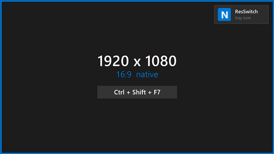
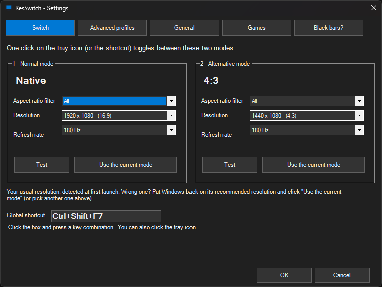
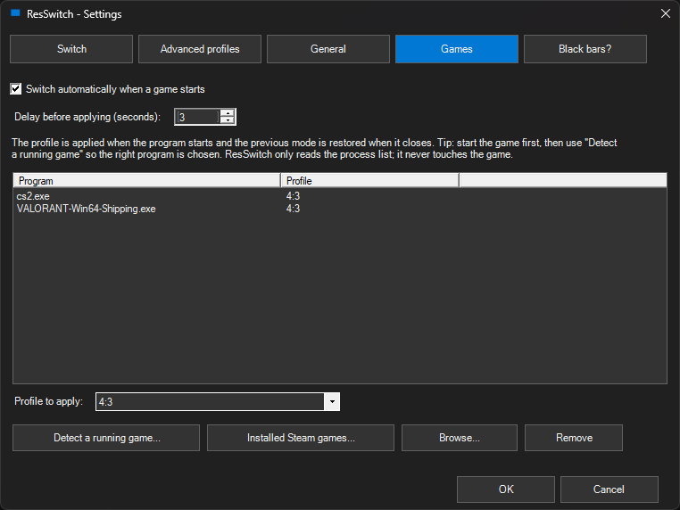
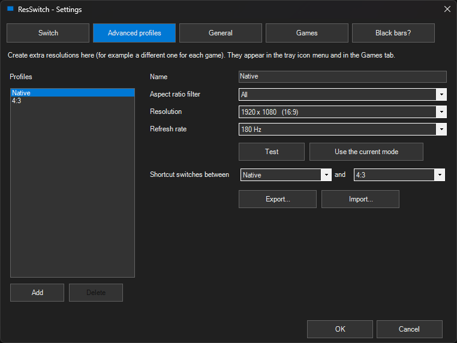

# ResSwitch

A small Windows tool that switches between your display's native resolution and a 4:3 resolution (or any other profile) with one click on the tray icon or a global hotkey.

Windows 10 / 11. No runtime to install, no admin rights needed. Works with NVIDIA, AMD and Intel graphics: only the Windows API is used.

## Demo



The recording shows the real resolution change triggered by the hotkey. The icon in the top-right corner is the tray icon exactly as ResSwitch draws it: `N` in native mode, `4:3` in a 4:3 mode. The black bars on the sides are what Windows shows when the graphics driver does not stretch the 4:3 image to the full screen (see [Full-screen stretching](#full-screen-stretching-depends-on-your-driver)).

## Screenshots







## Installation

Download the latest version from the [Releases](https://github.com/TraffyOFF/ResSwitch/releases/latest) page.

* **Installer**: `ResSwitch-Setup.exe`. Installs for the current user by default (`Program Files` is available as an option). Optional desktop shortcut, optional start with Windows, and an entry in "Installed apps". An update closes the running instance cleanly.
* **Portable**: `ResSwitch-<version>-portable.zip`, the exe alone. Run it from anywhere.

On first launch, ResSwitch detects the current resolution and refresh rate of the primary display (the **Native** profile) and the largest 4:3 resolution the display offers (the **4:3** profile). If the display offers none, pick one in the settings.

> Start ResSwitch for the first time while your display is in its native mode: that is the mode saved as "Native". The "Use the current mode" button lets you correct it later.

## Usage

* **Left-click** the tray icon, or press the **global hotkey** (default `Ctrl+Shift+F7`, chosen to avoid the NVIDIA overlay's `Alt+F9`, `Alt+F10`, `Alt+F12` and `Alt+Z`; it can be changed): toggles between the two chosen profiles. The icon shows `N` (native) or the aspect ratio (`4:3`, ...).
* **Right-click**: menu (switch, profiles, disable automatic switching, settings, quit).
* **Settings**: profiles (name, display, resolution, refresh rate, aspect ratio filter), a **Test** button that reverts automatically after 10 seconds, hotkey, start with Windows, return to native on exit, notifications, language, profile import/export as `.json`.
* A mode refused by the driver, or a display that is not connected, falls back to the native mode without a blocking error.
* The resolution change is dynamic: restarting Windows always returns to your usual Windows setting.

## Automatic switching per game

Settings > Games: associate a program (for example `cs2.exe`) with a profile. The profile is applied when the game starts and the previous mode is restored when it closes (the most recently started game wins).

* Works with Steam, Epic, Battle.net, GOG and others: a game is a regular Windows process with its own `.exe`.
* Easiest way: start the game, then use **"Detect a running game"**. **"Installed Steam games"** reads your Steam library and offers the `.exe` files found in the game's folder.
* Some games start through a small launcher that closes: target the game's real `.exe`, not the launcher.
* ResSwitch does not inject anything into games. It only reads the process list (like Task Manager) and only changes the display resolution through Windows. Compatible with VAC, EasyAntiCheat and BattlEye.

## Multiple displays

* In Settings > Advanced profiles, each profile can target a specific display. Displays are listed by their real monitor name (read from the monitor's EDID, for example "MSI G24C4 E2"), not by the graphics card name.
* A profile is pinned to the **physical monitor** (model and serial number), not to the `\\.\DISPLAYn` number that Windows reassigns when displays are plugged in or out. A profile set to the primary display follows whichever display is primary.
* Every extra display gets its own **Native** profile the first time it is seen, so returning to native (on exit, or after a refused mode) never applies one display's resolution to another.
* If a profile's monitor is not connected, ResSwitch shows a notification and returns the primary display to native instead of failing.
* The tray icon shows the mode of the primary display.

## Full-screen stretching (depends on your driver)

Windows changes the resolution, but the 4:3 image can keep black bars unless the graphics driver stretches it. A guide for your card is shown in Settings > "Black bars?" (indicative only, menu names change between driver versions):

| GPU | Path |
|---|---|
| NVIDIA | NVIDIA Control Panel > Display > Adjust desktop size and position > Scaling mode "Full-screen", performed on the GPU. Resolution missing: Change resolution > Customize > Create custom resolution. |
| AMD | AMD Software > Display > Scaling mode "Full panel", with "GPU Scaling" turned on. |
| Intel | Intel Graphics Command Center > Display > Scaling "Full-screen". |

## Updates

Disabled by default (offered at first launch). The check only reads the latest version number on GitHub (`releases/latest`). It sends no data and downloads or installs nothing: it shows "New version available" and opens the download page.

The repository that is queried is the `Repo` constant in `ResSwitch/UpdateCheck.cs` (`"owner/repository"`). Change it if you publish your own fork.

## SmartScreen and Smart App Control

Without a code-signing certificate (which is paid), Windows SmartScreen may show "Unknown publisher" on first download: click "More info", then "Run anyway". This does not prevent installation.

**Smart App Control**: on Windows 11 PCs where it is enabled, unsigned programs with no known reputation are **blocked outright, with no "Run anyway" option** (message "An application control policy has blocked this file"). This applies to `ResSwitch.exe` and to the installer as long as they are not signed. Options: sign the code (a code-signing certificate, or a signing service such as Azure Trusted Signing), or turn Smart App Control off in Windows Security > App & browser control (turning it off is permanent, so only do it knowingly). Signing is therefore recommended before a wide release.

**If you are blocked, or prefer to check what you run:**

* The whole source code is here: you can read it and build it yourself with `.\build.ps1` (only the compiler already included in Windows is needed). Note that this lets you inspect what you run but **does not get around Smart App Control**, which also blocks a locally built exe (observed during development).
* Compare the checksum of the downloaded file with the one on the release page: `Get-FileHash .\ResSwitch-Setup.exe -Algorithm SHA256`.
* Some antivirus products wrongly flag small unsigned programs that change the resolution or register a global hotkey. ResSwitch contacts no server (except the update check, which is off by default) and only changes the resolution through the Windows API.

## Languages

Français, English, Deutsch, Español, Italiano, Português, Nederlands, Polski. The Windows language is used by default and can be changed in the settings. The translations were written by an AI and deserve a review by native speakers.

To fix or add a language **without recompiling**: copy `ResSwitch/lang/en.json` to `xx.json` (two-letter language code), translate the values, and put it in a `lang` folder next to the exe or in `%AppData%\ResSwitch\lang\`. It then appears in the language list and overrides the built-in version.

## Files

* Configuration: `%AppData%\ResSwitch\config.json` (safe defaults if missing or corrupted; a corrupted file is copied to `config.json.bad`). Error log: `error.log` in the same folder. Set the `RESSWITCH_DATA` environment variable to use another folder.
* Uninstall: removes the program and the startup entry, and offers to delete your settings too.

## Building

Nothing to install on the .NET side: the `csc.exe` compiler included in Windows is enough (C# 5).

```powershell
.\build.ps1               # dist\ResSwitch.exe + portable .zip + installer if Inno Setup 6 is installed
.\build.ps1 -NoInstaller
```

Sources are in `ResSwitch/`, the installer script in `installer/ResSwitch.iss`. `tools\make-icon.ps1` regenerates `ResSwitch/app.ico`.

The files on the Releases page are built by GitHub Actions from the tagged source with this same script (`.github/workflows/build.yml`), and the checksums are listed in the release notes.

## Known limitations

Tested on a single PC, a single display and an NVIDIA GPU. Multi-display support is implemented but has only been tested with one display, so please report any problem with two or more. AMD, Intel, the actual stretched rendering, the translations and SmartScreen behavior still need validation by other users. Feedback and issues are welcome.

## License

[MIT](LICENSE)
